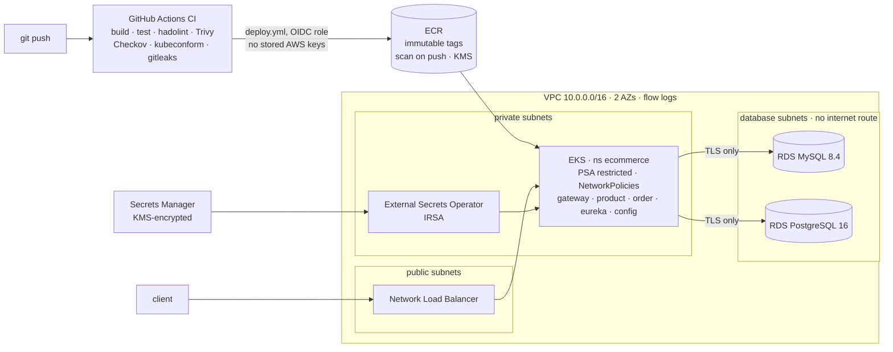

# E-commerce Microservices: Spring Boot & Spring Cloud

A small e-commerce backend built as **microservices** with **Spring Boot 4.0** and **Spring Cloud 2025.1**. It shows service discovery, centralised configuration, an API gateway with circuit breakers, inter-service calls with OpenFeign, and a separate database per service.

It runs three ways: **Docker Compose** on a laptop, **Kubernetes** locally (kind), and **AWS EKS** provisioned with **Terraform**, deployed by a **DevSecOps pipeline** that blocks vulnerable images and misconfigured infrastructure. See [Cloud deployment on AWS](#cloud-deployment-on-aws-eks).

---

## Architecture

```
                         ┌─────────────────────┐
     Client ───────────► │  API Gateway :8080  │  Spring Cloud Gateway
                         │  + Resilience4j CB  │  (fallbacks on /fallback/*)
                         └─────────┬───────────┘
                    lb://PRODUCT-SERVICE   lb://ORDER-SERVICE
                 ┌─────────────────┴──────────────────┐
                 ▼                                    ▼
      ┌──────────────────────┐   OpenFeign   ┌──────────────────────┐
      │ Product Service :8081│ ◄──────────── │  Order Service :8082 │
      └──────────┬───────────┘ (stock check) └──────────┬───────────┘
                 ▼                                      ▼
          MySQL 8 :3306                         PostgreSQL :5432
           (productdb)                              (orderdb)

      ┌──────────────────────┐     ┌──────────────────────┐
      │ Eureka Server :8761  │     │ Config Server :8888  │
      │ (service registry)   │     │ (native profile)     │
      └──────────────────────┘     └──────────────────────┘
```

| Service | Port | Role |
|---|---|---|
| `eureka-server` | 8761 | Service registry (Netflix Eureka) |
| `config-server` | 8888 | Centralised configuration (Spring Cloud Config, `native` profile) |
| `api-gateway` | 8080 | Single entry point; routes `/api/products/**` and `/api/orders/**` with circuit breakers |
| `product-service` | 8081 | Product catalogue and stock (MySQL) |
| `order-service` | 8082 | Orders; checks and decrements stock through Feign (PostgreSQL) |

## Tech stack

- **Java 17**, **Spring Boot 4.0**, **Spring Cloud 2025.1** (Hibernate 7, Spring Framework 7)
- Spring Cloud **Gateway**, **Netflix Eureka**, **Config Server**, **OpenFeign**
- **Resilience4j** circuit breakers (gateway + Feign client)
- **Spring Data JPA** + **Bean Validation**
- **MySQL 8** (products), **PostgreSQL 15** (orders)
- **springdoc-openapi** (Swagger UI), **Spring Boot Actuator**
- **Docker** multi-stage builds (non-root, healthchecked) + **Docker Compose**
- **AWS**: VPC, EKS, ECR, RDS (MySQL 8.4, PostgreSQL 16), KMS, Secrets Manager, IAM (OIDC + IRSA), all in **Terraform**
- **Kubernetes**: Kustomize overlays, NetworkPolicies, Pod Security Admission, HPA, External Secrets Operator
- **CI/CD**: GitHub Actions with hadolint, Trivy, Checkov, kubeconform, gitleaks

## Getting started

### Option 1: Docker Compose (recommended)

Prerequisites: Docker and Docker Compose.

```bash
git clone https://github.com/fidaaltf58/Microservices.git
cd Microservices
docker compose up -d --build
```

Services start in dependency order (databases → Eureka → Config → Gateway → Product → Order) using health checks. The first build takes a few minutes because Maven runs inside each image.

| URL | What |
|---|---|
| <http://localhost:8761> | Eureka dashboard |
| <http://localhost:8080/api/products> | Products through the gateway |
| <http://localhost:8080/api/orders> | Orders through the gateway |
| <http://localhost:8081/swagger-ui.html> | Product Service Swagger UI |
| <http://localhost:8082/swagger-ui.html> | Order Service Swagger UI |
| <http://localhost:8080/actuator/health> | Gateway health |

```bash
docker compose logs -f order-service   # follow logs
docker compose down -v                 # stop and delete the data volumes
```

### Option 2: Run locally with Maven

Prerequisites: JDK 17, Maven 3.9.

```bash
# 1. Start the databases
docker compose up -d mysql postgres

# 2. Point the services at a local Eureka instance
export EUREKA_CLIENT_SERVICEURL_DEFAULTZONE=http://localhost:8761/eureka/

# 3. Start each service in its own terminal, in this order
cd eureka-server   && mvn spring-boot:run
cd config-server   && mvn spring-boot:run
cd product-service && mvn spring-boot:run
cd order-service   && mvn spring-boot:run
cd api-gateway     && mvn spring-boot:run
```

Wait for Eureka (<http://localhost:8761>) to be up before starting the other services.

## API

All endpoints are available through the gateway on port `8080`.

### Products: `/api/products`

| Method | Endpoint | Description |
|---|---|---|
| `GET` | `/api/products` | List all products |
| `GET` | `/api/products/{id}` | Get a product |
| `POST` | `/api/products` | Create a product |
| `PUT` | `/api/products/{id}` | Update a product |
| `DELETE` | `/api/products/{id}` | Delete a product |
| `GET` | `/api/products/category/{category}` | Filter by category |
| `GET` | `/api/products/search?name=` | Search by name |
| `GET` | `/api/products/available` | Products in stock |
| `PATCH` | `/api/products/{id}/stock?quantity=` | Adjust stock by `quantity` (negative to decrease; rejected if stock would go below 0) |

### Orders: `/api/orders`

| Method | Endpoint | Description |
|---|---|---|
| `GET` | `/api/orders` | List all orders |
| `GET` | `/api/orders/{id}` | Get an order |
| `GET` | `/api/orders/number/{orderNumber}` | Get by order number |
| `POST` | `/api/orders` | Place an order (checks stock in Product Service) |
| `PATCH` | `/api/orders/{id}/status?status=` | Update status |
| `DELETE` | `/api/orders/{id}` | Cancel an order |
| `GET` | `/api/orders/customer/{email}` | Orders for a customer |
| `GET` | `/api/orders/status/{status}` | Filter by status |

Order statuses: `PENDING`, `CONFIRMED`, `PROCESSING`, `SHIPPED`, `DELIVERED`, `CANCELLED`.

### Example

```bash
# Create a product
curl -X POST http://localhost:8080/api/products \
  -H "Content-Type: application/json" \
  -d '{"name":"Laptop","description":"14-inch","price":999.99,"stockQuantity":10,"category":"Electronics","active":true}'

# Place an order
curl -X POST http://localhost:8080/api/orders \
  -H "Content-Type: application/json" \
  -d '{"customerName":"Jane Doe","customerEmail":"jane@example.com","shippingAddress":"1 Main St",
       "items":[{"productId":1,"quantity":2}]}'
```

## Resilience

- **Gateway circuit breakers** (`productCircuitBreaker`, `orderCircuitBreaker`): sliding window of 10 calls, 50% failure threshold, 10 s open state. When a service is down, the gateway forwards to `/fallback/products` or `/fallback/orders`.
- **Feign circuit breaker** in Order Service (`productService`), with fallbacks for `getProduct` and `updateStock`.

## Cloud deployment on AWS (EKS)

The same services run on **Amazon EKS**, with every AWS resource defined in Terraform and every deployment going through a security-gated pipeline.



### Security controls

| Layer | Control | Where |
|---|---|---|
| Identity | GitHub Actions assumes an AWS role through **OIDC**, restricted to `main` of this repo; no access keys exist | `infra/terraform/iam.tf` |
| Identity | CI/CD can only touch the `ecommerce` namespace (EKS access entry, namespace-scoped policy) | `infra/terraform/eks.tf` |
| Identity | External Secrets reads exactly two secrets via **IRSA**; pods cannot reach node credentials (IMDSv2, hop limit 1) | `iam.tf`, `eks.tf` |
| Network | 3-tier VPC: databases in subnets with no internet route; DB security groups accept only the EKS nodes | `vpc.tf`, `rds.tf` |
| Network | **Default-deny NetworkPolicies**: only gateway → product/order, order → product, services → Eureka, DB ports | `k8s/base/network-policies.yaml` |
| Network | EKS API endpoint private, public only from `admin_cidrs` (0.0.0.0/0 rejected by validation) | `variables.tf` |
| Data | KMS (rotated) for ECR, RDS storage and Secrets Manager; EKS envelope-encrypts Kubernetes Secrets | `main.tf`, `eks.tf` |
| Data | RDS **rejects non-TLS connections** (`require_secure_transport`, `rds.force_ssl`); JDBC URLs require TLS | `rds.tf` |
| Data | No credentials in git: Terraform writes them to Secrets Manager, ESO syncs them into the cluster | `k8s/overlays/aws/external-secrets.yaml` |
| Workload | **Pod Security Admission `restricted`**: non-root (UID 10001), read-only root FS, all capabilities dropped, seccomp, no SA token | `k8s/namespace`, `k8s/base/*.yaml` |
| Workload | Gateway actuator (route management, the CVE-2022-22947 attack surface) is not exposed | `api-gateway/.../application.yml` |
| Supply chain | Every action pinned to a commit SHA; images tagged with the commit SHA in **immutable** ECR repos | `.github/workflows` |
| Supply chain | Build fails on fixable HIGH/CRITICAL CVEs (Trivy) and on IaC misconfigurations (Checkov) | `ci.yml`, `deploy.yml` |
| Audit | EKS control-plane logs (API, audit, authenticator), VPC flow logs, RDS logs and Enhanced Monitoring | `eks.tf`, `vpc.tf`, `rds.tf` |

Every Checkov finding that is deliberately not fixed carries an inline `#checkov:skip` with the reason (for example, Multi-AZ is a variable that is off in dev to save cost).

### What the security gates found

Turning on the Trivy gate showed that the original Spring Boot 3.2.0 stack shipped **about 300 known, fixable HIGH/CRITICAL vulnerabilities** (47 critical, in Spring, Tomcat, Netty, Jackson, Logback and the JDBC drivers). The fix:

1. Upgraded to Spring Boot 3.5, which removed most of them but left critical Spring Framework CVEs that are only fixed in Framework 7 (Boot 3.5 open-source support ended in June 2026).
2. Migrated to **Spring Boot 4.0.9 / Spring Cloud 2025.1.3** (Gateway server-webflux properties, Hibernate 7 dialect detection, resilience4j-spring-boot4, springdoc 3).
3. Overrode one transitive library (`httpcore5`) that Boot 4.0.9 still pins to a vulnerable version.
4. Removed the unused `jjwt` dependency and the exposed gateway actuator.

Result: **0 fixable HIGH/CRITICAL vulnerabilities** in the Maven dependency tree.

It also surfaced four bugs that broke `docker compose up`: a stray `ENTRYPOINT` before `FROM` in the config-server Dockerfile, healthchecks calling `curl` (absent from the Alpine JRE image), order-service calling product-service on `localhost` inside its container, and an `EXPOSE` on the wrong port. A fifth was in the registry itself: Eureka listed its own URL as a peer and replicated every registration to itself (fixed with the standard standalone configuration).

### Deploy it

Prerequisites: AWS CLI, Terraform >= 1.10, kubectl, Helm.

```bash
# 1. Infrastructure (about 15-20 minutes)
cd infra/terraform
cp backend.hcl.example backend.hcl            # S3 bucket for state
cp terraform.tfvars.example terraform.tfvars  # set admin_cidrs to your IP
terraform init -backend-config=backend.hcl
terraform apply

# 2. One-time cluster setup: External Secrets Operator, metrics-server, namespace, secret store
cd ../.. && ./scripts/bootstrap-cluster.sh

# 3. In GitHub: Settings > Secrets and variables > Actions > Variables
#    AWS_REGION, AWS_ROLE_ARN (github_actions_role_arn), EKS_CLUSTER_NAME (cluster_name)
#    Then run the "Deploy to EKS" workflow. It prints the gateway URL when the smoke test passes.

# 4. Tear down when done
cd infra/terraform && terraform destroy
```

**Run the Kubernetes version locally for free** (Docker + [kind](https://kind.sigs.k8s.io/)): `./scripts/local-up.sh`

### Cost

This is a dev stack meant to be created, demonstrated and destroyed. Running, it costs roughly **$0.25/hour (about $6/day)** in `eu-west-3`: EKS control plane $0.10/h, NAT gateway, two Spot `t3.medium` nodes, two `db.t4g.micro` databases and the load balancer. Always run `terraform destroy` afterwards.

### Verification

| Check | Result |
|---|---|
| `mvn verify` (all 5 services; product and order boot their full context against H2) | Pass |
| Eureka, Config Server and gateway started with the cluster's ConfigMap env: liveness/readiness probes, Eureka registration by IP, gateway routes and circuit-breaker fallbacks | Pass |
| `terraform validate` / `fmt` | Pass |
| Checkov, Terraform | 140 passed, 0 failed |
| Checkov, Kubernetes (AWS overlay as deployed) | 451 passed, 0 failed |
| Checkov, Dockerfiles / hadolint | 300 passed, 0 failed / clean |
| kubeconform, Kubernetes 1.33 schema (both overlays, CRDs included) | 70 resources valid |
| Trivy, Maven dependencies | 0 fixable HIGH/CRITICAL |

### Roadmap

- HTTPS: AWS Load Balancer Controller + ALB Ingress with an ACM certificate (the NLB currently serves HTTP).
- Automatic DB credential rotation (Secrets Manager rotation Lambda + Reloader to restart pods).
- Per-service DB users with least privilege instead of the RDS master user.
- Prometheus + Grafana via kube-prometheus-stack; image signing with cosign and admission verification.

## Project structure

```
Microservices/
├── eureka-server/  config-server/  api-gateway/  product-service/  order-service/
├── docker-compose.yml
├── infra/terraform/          # AWS: VPC, EKS, ECR, RDS, KMS, Secrets Manager, IAM
├── k8s/
│   ├── namespace/            # app namespace + Pod Security Admission (cluster-admin)
│   ├── base/                 # Deployments, Services, NetworkPolicies, HPA, PDB
│   └── overlays/
│       ├── aws/              # NLB for the gateway, ExternalSecrets -> Secrets Manager
│       └── local/            # kind: in-cluster MySQL/PostgreSQL
├── scripts/                  # bootstrap-cluster.sh (EKS add-ons), local-up.sh (kind)
├── .github/workflows/        # ci.yml (build, scan, IaC checks), deploy.yml (OIDC -> ECR -> EKS)
└── pom.xml                   # parent aggregator
```

## Author

**Fidaa Letaief** · [@fidaaltf58](https://github.com/fidaaltf58)
